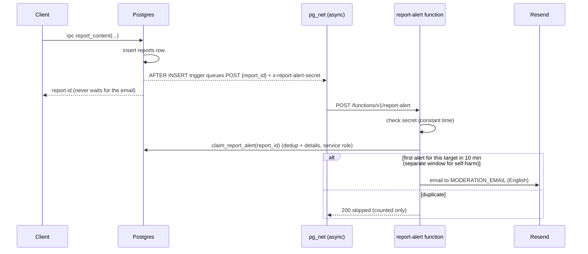

# Moderation alerts

Apple expects reports to be acted on within 24 hours. Every new row in `public.reports` (created only by `report_content`) emails the moderation inbox.



- **Fire-and-forget**: the trigger only queues an HTTP request through `pg_net`, inside an exception handler. A missing secret, an unreachable function or an email failure never fails the report (tested).
- **Content of the email**:
  - reason, target type and id, and the time sent;
  - the bubble's name and id;
  - display names and ids of the reporter and the reported user;
  - a snippet of the content, up to 300 characters: the message text, the title and description, or the URL;
  - an image link, if any;
  - the details text;
  - **open reports against the user in the last 30 days**, and reports on this target in the last 10 minutes.

  It contains **no email addresses**. Self-harm reports have a subject starting with **`URGENT:`**.
- **Deduplication**: at most one email per target per 10 minutes. Later reports in that window are only counted and appear in the next alert's counters. A self-harm report has its own window, so a preceding spam report can't swallow it. If sending fails, the claim is released.
- **Columns for the admin view**:
  - `reports.status` (`open` / `actioned` / `dismissed`, default `open`; it already existed);
  - `handled_at`;
  - `handled_note`;
  - `alert_sent_at`.

  Clients can't insert, update or delete reports. The reporter can still read their own reports, as before (`reports_select_own`).

## Production setup
1. Run the migration `20261122170000_moderation_alerts.sql` (it enables `pg_net`).
2. Store the trigger target and the shared secret in Vault (SQL editor):
   ```sql
   select vault.create_secret('https://<project-ref>.supabase.co/functions/v1/report-alert', 'report_alert_url');
   select vault.create_secret('<openssl rand -hex 32>', 'report_alert_secret');
   ```
   To rotate, use `select vault.update_secret((select id from vault.secrets where name = 'report_alert_secret'), '<new>');`.
3. Set the function secrets: `supabase secrets set REPORT_ALERT_SECRET=<same value> MODERATION_EMAIL=moderation@boolaa.ro RESEND_API_KEY=...`.
4. Deploy: `supabase functions deploy report-alert` (`verify_jwt = false`, because the secret header authenticates the call).
5. **Cloudflare Email Routing** (the user sets this up): create a rule `moderation@boolaa.ro` → the team's inbox. Without it, Resend delivers to an address nobody reads.
6. Check it: report something with a test account and see the email arrive. `select * from net._http_response order by created desc limit 5;` shows the trigger's calls.

Locally the URL is `http://kong:8000/functions/v1/report-alert` and the secret is `local-report-alert-secret-change-me`. Both are set in `seed.sql` and `supabase/functions/.env`, and the email lands in Mailpit (to `moderation@boolaa.ro`).

# Moderation admin view and account suspension

Migration `20261122180000_moderation_admin.sql`; web UI at **`/admin`** (`apps/boolaa-web/src/app/admin`).

## Who can moderate
- Admins are rows in `public.admins` (no client policies). `is_admin()` tells the caller whether they are one.
- Every admin RPC raises `permission denied` (42501) for anyone else, then requires a verified session (`require_verified_session()`: device check, 16+, active account). So an admin must pass the emailed device check once the flag is on.
- `/admin` answers **404** to everyone who isn't an admin, signed-out visitors included. It is `noindex`, not in the sitemap and not linked from the app. Its strings are English only (`src/app/admin/strings.ts`, outside next-intl).
- Locally: `mod@boolaa.test` / `password123` is an admin (device `boolaa-test-device` trusted). The seed has two open reports by Erin about Dave in "Book Club", one 21 h old.

## How to moderate
1. Open the link in the alert email (`https://boolaa.ro/admin?report=<id>`): that report is shown first, with its context. Or open `/admin`: the **Open** tab lists self-harm reports first, then the oldest first. Anything older than 20 h shows its age in red.
2. Each card shows the reason, the content as it is now (or "Content deleted"), who reported whom and in which bubble (names and ids), the open reports against that user in the last 30 days, and the reporter's note. **Show context** loads the 5 chat messages before and after, other reports on the same target and the audit log.
3. Pick an action, optionally with an internal note. Each asks for confirmation:

| Action | Effect |
|---|---|
| Dismiss | Nothing changes; report `dismissed`. |
| Delete content | Deletes the message / event / food post / item / link row. Not for profile reports. The uploaded photo (food post, marketplace item) is deleted too: the RPC records its bucket and path in the audit row and returns them, and the admin view removes the object through the Storage API (a storage policy allows an admin to delete exactly the objects named by a `delete_content` audit row). If that removal fails, the view names the object to delete by hand in the dashboard (Storage). |
| Remove from bubble | Deletes the membership; the usual trigger hands ownership on, deletes an empty bubble, strips votes and admits queued requests. No owner needed. |
| Suspend 1 / 7 / 30 days | `users.status = 'suspended'`, `status_until`, `status_reason` = the report reason; `auth.users.banned_until` = the same moment. |
| Ban | `status = 'banned'`, GoTrue ban for 100 years, and the user is removed from every bubble (so they don't hold a seat or a vote forever). |

   The report becomes `actioned` (or `dismissed`) with `handled_at` and `handled_note`, and **every other open report on the same target is closed the same way**. Every action is written to `moderation_actions` (admin, action, target, report, note, details), which only admins can read.
4. **Users** tab: search by name or user id to see status, reports and bubbles, and lift a suspension or ban (`admin_unsuspend`). Also logged.

RPCs (all `security definer`, admin-only): `admin_list_reports(p_status, p_limit, p_offset)`, `admin_get_report(p_report_id)`, `admin_resolve_report(p_report_id, p_action, p_note, p_days)`, `admin_unsuspend(p_user_id, p_note)`, `admin_find_users(p_query, p_limit)`. Errors: `report already handled`, `invalid suspension length`, `a user report has no content to delete`, `member not found`, `reported user no longer exists`, `cannot act on yourself`, `user is banned`.

## What suspension does
- `is_session_verified()` now also needs `is_account_active()`: not banned, and not suspended with `status_until` in the future. Every RLS policy and RPC goes through it, so a suspended user reads nothing (bubbles, content, members, realtime) and can't post or call RPCs (`account suspended`).
- Exceptions: their **own `users` row** (status, reason, until; needs the device check), their own storage objects (list/delete) and `delete_my_account()`.
- A suspension **ends by itself** at `status_until`; no job runs. Clients must apply the same rule: inactive = `banned`, or `suspended` and (`status_until` is null or in the future).
- GoTrue (measured on the local v2.186): with `banned_until` in the future, password and OTP sign-in and token refresh answer 400 `user_banned` ("User is banned"). An access token issued earlier stays valid until it expires (up to 1 h); `GET /auth/v1/user` still answers with it, and RLS blocks the data. So a signed-in user sees the suspended screen with reason and date until the token expires; after that, sign-in fails and the client can only show a generic "suspended or banned" message (no session, so no reason or date).
- **Content stays visible** to the bubble. Hiding it would mean changing every content policy, and it would also hide the conversation the reporters were part of. Remove what was reported with *Delete content*. `users.status` is readable by bubble mates (like the name), so `status_reason` only holds a category, never the moderator's note.
- A banned user can't sign in again, so they can't delete their account in the app: handle erasure requests to privacy@boolaa.ro by deleting the user in the dashboard.

## Clients
- **Web**: `/suspended` (strings in `messages/*.json` → `suspended`). The proxy sends a signed-in, inactive account there instead of the device gate; the login page goes there on `user_banned`. It shows the reason and end date when it can, the appeal address privacy@boolaa.ro and sign out.
- **iOS / Android (still to do)**: after sign-in / session restore, when `is_session_verified()` is false and `start_device_check` says verified, read the own `users` row (`status, status_reason, status_until`); if inactive, show a suspended screen (title, "until <date>", reason via the existing report-reason strings, appeal link `mailto:privacy@boolaa.ro`, sign out). Map the sign-in error code `user_banned` to the same screen without details. Reuse the web's `suspended.*` texts for all 5 languages.

## Production rollout
1. Push the migration: `supabase db push` (applies `20261122180000_moderation_admin.sql`). It changes no behaviour for existing users (everyone is `active`).
2. Make the lead an admin (SQL editor, once):
   ```sql
   insert into public.admins (user_id) select id from auth.users where email = '<lead email>';
   ```
   Remove with `delete from public.admins where user_id = '<id>'`.
3. Redeploy the alert function so emails carry the admin link: `supabase functions deploy report-alert` (optional secret `ADMIN_URL`, default `https://boolaa.ro/admin`).
4. Deploy the web app (push to `main`), then open `https://boolaa.ro/admin` signed in as the admin; anyone else gets a 404.

## SLA practice
- Check the **Open** queue at least once a day, even without an email (mail can fail; the queue is the source of truth). Apple expects action within **24 hours**; the age turns red after 20 h.
- **Self-harm reports: handle immediately** when the URGENT email arrives. Don't punish by default; usually dismiss or remove content with a note, and if someone may be in danger, reach out to the reporter with crisis resources (Romania: 112, Telefonul Sufletului 0800 801 200; elsewhere https://findahelpline.com). Never share the reporter's identity.
- Prefer the lightest action that stops the harm: delete content, then remove from bubble, then suspend (1 → 7 → 30 days), and ban for spam bots, threats or repeat offenders. Always write a note: it is the audit trail for appeals.
- Appeals arrive at privacy@boolaa.ro; check the audit log (`moderation_actions`) and lift with the Users tab if warranted.
