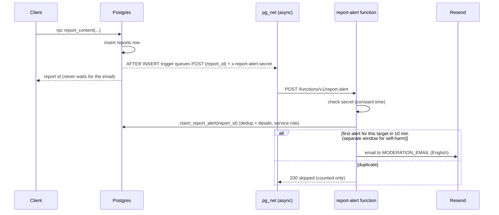

# Moderation alerts

Apple expects reports to be acted on within 24 hours. Every new row in `public.reports` (created only by `report_content`) emails the moderation inbox.



- **Fire-and-forget**: the trigger only queues an HTTP request through `pg_net`, inside an exception handler. A missing secret, an unreachable function or an email failure never fails the report (tested).
- **Content of the email**:
  - reason, target type and id, and the time sent;
  - the bubble's name and id;
  - display names and ids of the reporter and the reported user;
  - a snippet of the content, up to 300 characters: the message text, the title and description, or the URL;
  - an image link, if any;
  - the details text;
  - **open reports against the user in the last 30 days**, and reports on this target in the last 10 minutes.

  It contains **no email addresses**. Self-harm reports have a subject starting with **`URGENT:`**.
- **Deduplication**: at most one email per target per 10 minutes. Later reports in that window are only counted and appear in the next alert's counters. A self-harm report has its own window, so a preceding spam report can't swallow it. If sending fails, the claim is released.
- **Columns for the admin view**:
  - `reports.status` (`open` / `actioned` / `dismissed`, default `open`; it already existed);
  - `handled_at`;
  - `handled_note`;
  - `alert_sent_at`.

  Clients can't insert, update or delete reports. The reporter can still read their own reports, as before (`reports_select_own`).

## Production setup
1. Run the migration `20261122170000_moderation_alerts.sql` (it enables `pg_net`).
2. Store the trigger target and the shared secret in Vault (SQL editor):
   ```sql
   select vault.create_secret('https://<project-ref>.supabase.co/functions/v1/report-alert', 'report_alert_url');
   select vault.create_secret('<openssl rand -hex 32>', 'report_alert_secret');
   ```
   To rotate, use `select vault.update_secret((select id from vault.secrets where name = 'report_alert_secret'), '<new>');`.
3. Set the function secrets: `supabase secrets set REPORT_ALERT_SECRET=<same value> MODERATION_EMAIL=moderation@boolaa.ro RESEND_API_KEY=...`.
4. Deploy: `supabase functions deploy report-alert` (`verify_jwt = false`, because the secret header authenticates the call).
5. **Cloudflare Email Routing** (the user sets this up): create a rule `moderation@boolaa.ro` → the team's inbox. Without it, Resend delivers to an address nobody reads.
6. Check it: report something with a test account and see the email arrive. `select * from net._http_response order by created desc limit 5;` shows the trigger's calls.

Locally the URL is `http://kong:8000/functions/v1/report-alert` and the secret is `local-report-alert-secret-change-me`. Both are set in `seed.sql` and `supabase/functions/.env`, and the email lands in Mailpit (to `moderation@boolaa.ro`).
